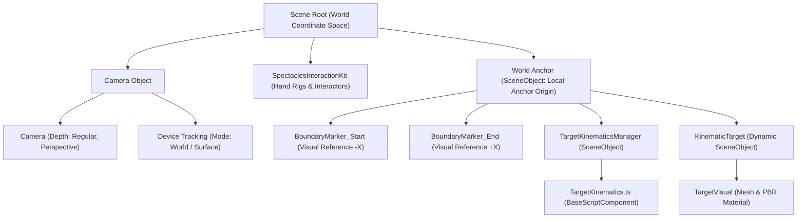
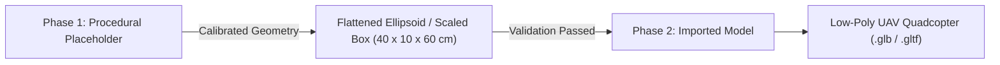
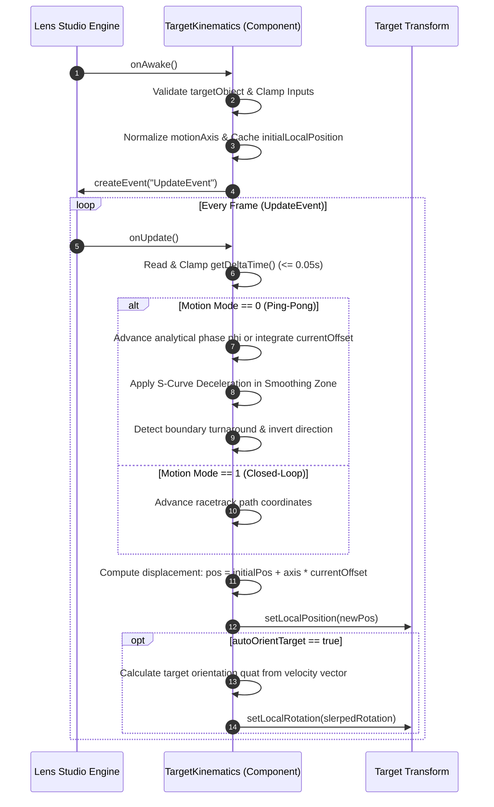
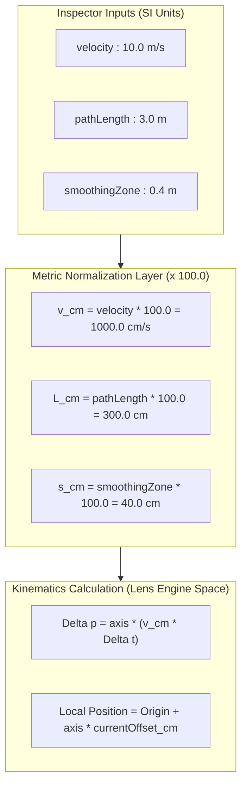
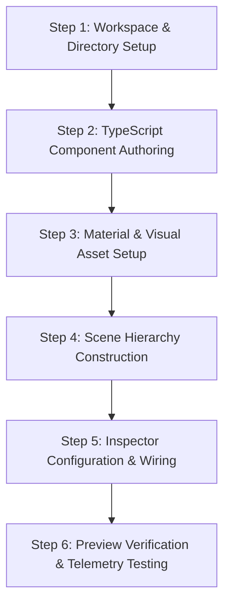

# Feature 1 Implementation Plan: Spatial Test Range & Target Kinematics

| Document Metadata | Details |
| :--- | :--- |
| **Plan ID** | PLAN-FR-001 |
| **Specification Reference** | [`specs/feature-1-spatial-range.md`](file:///d:/Hackathon/AR_with_Specs/Specs_Test/specs/feature-1-spatial-range.md) |
| **Target Runtime** | Lens Studio 5.24+ (Spectacles / World AR) |
| **Language** | TypeScript (ES2021, LensifyTS) |
| **Status** | Ready for Execution |

---

## 1. Scene Graph & Hierarchy Setup

The scene hierarchy isolates the high-velocity simulation within an anchored local coordinate frame, preventing AR tracking latency or user head rotations from causing translational shear.

### 1.1 Target Hierarchy Diagram



### 1.2 Hierarchy Provisioning via CLAD Bridge / Editor Code
When provisioning the scene hierarchy through the CLAD bridge (or Lens Studio Editor Scripting), execute the following isolated operations:

1. **Verify World Tracking Camera**:
   - Locate existing `Camera Object` in `Assets/Scene.scene`.
   - Confirm presence of `DeviceTracking` component configured with `DeviceTrackingMode.World`.
2. **Instantiate `World Anchor`**:
   - Create a top-level `SceneObject` titled `World Anchor`.
   - Set transform:
     - `Position`: `(0.0, -20.0, -250.0)` cm (placed $2.5\text{ m}$ forward from user, slightly below eye level at $-20\text{ cm}$ for comfortable ergonomic viewing on Spectacles).
     - `Rotation`: `(0.0, 0.0, 0.0)` degrees.
     - `Scale`: `(1.0, 1.0, 1.0)`.
3. **Instantiate `KinematicTarget`**:
   - Create child `SceneObject` titled `KinematicTarget` parented to `World Anchor`.
   - Set local transform: `Position = (0, 0, 0)`, `Rotation = (0, 0, 0)`, `Scale = (1, 1, 1)`.
4. **Instantiate `TargetKinematicsManager`**:
   - Create child `SceneObject` titled `TargetKinematicsManager` parented to `World Anchor`.
   - Attach script component `TargetKinematics.ts`.
   - Bind input property `targetObject` to `KinematicTarget`.
5. **Instantiate Boundary Datum Markers (Optional Visual Calibration)**:
   - Create `BoundaryMarker_Start` at local position `(-150.0, 0.0, 0.0)` cm.
   - Create `BoundaryMarker_End` at local position `(+150.0, 0.0, 0.0)` cm.

---

## 2. Asset Allocation & Visual Configuration

### 2.1 Mesh Selection: Procedural Primitive vs. Imported Drone
To guarantee immediate compile stability, reproducible scale, and zero runtime loading hitches, asset allocation is partitioned into two phases:



1. **Phase 1 (Immediate / Prototype)**:
   - **Geometry**: Procedural Box or Cylinder mesh.
   - **Dimensions**: Scaled to represent a standard medium UAV drone ($40\text{ cm}$ width $\times$ $10\text{ cm}$ height $\times$ $60\text{ cm}$ length).
   - **Orientation Indicator**: An elongated forward nosecone (or forward-facing arrow primitive) along local $+Z$ to verify heading realignment during flight.
2. **Phase 2 (Production)**:
   - **Asset Format**: Low-poly GLB / glTF (`Assets/Models/UAVDrone.glb`).
   - **Polygon Budget**: $< 5,000$ triangles to preserve 60 FPS thermal limits on Spectacles hardware.

### 2.2 Material & Shader Setup for Optical AR
Because Snap Spectacles uses an **additive optical waveguide display**, pure black (`#000000`) renders as completely transparent, and dark colors lose contrast against real-world lighting.

- **Material Type**: Standard PBR Material (`Assets/Materials/TargetIndicator.mat`).
- **Color Parameters**:
  - `Base Color`: Electric Cyan (`#00E5FF`) or High-Visibility Amber (`#FF9100`).
  - `Roughness`: `0.25` (sharp specular highlights under environmental HDR lighting).
  - `Metallic`: `0.10`.
  - `Emissive Channel`: Subtle rim glow (`0.2` intensity) to prevent silhouette loss against dark backgrounds.
- **Layer Allocation**: Assigned to default render layer (`Layer 1`).

---

## 3. Script Architecture: `Assets/Scripts/TargetKinematics.ts`

The motion controller script is implemented in TypeScript extending `BaseScriptComponent`.

### 3.1 Class Blueprint & Exposed Decorators

```typescript
import { BaseScriptComponent } from "LensifyTS/Declarations/BaseScriptComponent";

@component
export class TargetKinematics extends BaseScriptComponent {
    // ----------------------------------------------------
    // EXPOSED INSPECTOR INPUTS
    // ----------------------------------------------------
    @ui.group_start("Flight Kinematics")
    
    @input
    @label("Velocity (m/s)")
    @hint("Target travel speed in meters per second (5.0 to 35.0 m/s)")
    @widget(new SliderWidget(5.0, 35.0, 0.5))
    velocity: number = 10.0;

    @input
    @label("Path Length (m)")
    @hint("Stroke distance between boundaries in meters (2.0 to 5.0 m)")
    @widget(new SliderWidget(2.0, 5.0, 0.1))
    pathLength: number = 3.0;

    @input
    @label("Target Entity")
    @hint("SceneObject representing the drone to displace")
    targetObject!: SceneObject;

    @input
    @label("Motion Mode")
    @hint("Ping-Pong linear oscillation vs. Continuous Closed-Loop")
    @widget(new ComboBoxWidget([
        new ComboBoxItem("Linear Ping-Pong", 0),
        new ComboBoxItem("Continuous Closed-Loop", 1)
    ]))
    motionMode: number = 0;

    @input
    @label("Motion Axis")
    @hint("Direction vector of flight path in local space")
    motionAxis: vec3 = new vec3(1.0, 0.0, 0.0);

    @input
    @label("Smoothing Zone (m)")
    @hint("Boundary buffer distance for turnaround deceleration (0.1 to 1.0 m)")
    @widget(new SliderWidget(0.1, 1.0, 0.05))
    smoothingZone: number = 0.4;

    @input
    @label("Auto-Orient Target")
    @hint("Align target forward heading with instantaneous velocity vector")
    autoOrientTarget: boolean = true;

    @ui.group_end

    // ----------------------------------------------------
    // INTERNAL STATE VARIABLES
    // ----------------------------------------------------
    private direction: number = 1.0;            // Current movement direction (+1.0 or -1.0)
    private currentOffset: number = 0.0;         // Linear offset along axis (in centimeters)
    private accumulatedPhase: number = 0.0;      // Continuous phase variable phi in [0, 1)
    private initialLocalPosition!: vec3;         // Origin position of targetObject
    private normalizedAxis!: vec3;               // Normalized unit motion vector
    private updateEvent!: SceneEvent;            // Cached update event handle
}
```

### 3.2 State Machine & Update Loop Lifecycle



### 3.3 Methods Specification
- **`onAwake(): void`**:
  - Validates `targetObject` existence (logs warning if null).
  - Normalizes `motionAxis` via `this.motionAxis.normalize()`.
  - Captures `this.initialLocalPosition = this.targetObject.getTransform().getLocalPosition()`.
  - Subscribes `this.updateEvent = this.createEvent("UpdateEvent"); this.updateEvent.bind(this.onUpdate.bind(this));`.
- **`onUpdate(): void`**:
  - Computes clamped delta: $\Delta t_{\text{clamped}} = \min(\text{getDeltaTime}(), 0.05)$.
  - Calculates step displacement and smooth boundary turnaround.
  - Updates position and rotation on `targetObject.getTransform()`.

---

## 4. Coordinate Normalization & Metric Scale Mathematics

Lens Studio internally calculates transformations in **centimeters** ($1\text{ world unit} = 1\text{ cm}$). All user-facing controls operate in standard SI metric units (meters, meters per second).



### 4.1 Conversion Formulas

1. **Path Length Normalization**:
   $$L_{\text{cm}} = \text{pathLength} \times 100.0$$
   *Range*: $\text{pathLength} \in [2.0, 5.0]\text{ m} \implies L_{\text{cm}} \in [200.0, 500.0]\text{ cm}$.
   *Travel Envelope*: Centered at anchor datum: $x_{\text{local}} \in \left[-\frac{L_{\text{cm}}}{2}, +\frac{L_{\text{cm}}}{2}\right]$.

2. **Velocity Normalization**:
   $$v_{\text{cm/s}} = \text{velocity} \times 100.0$$
   *Range*: $\text{velocity} \in [5.0, 35.0]\text{ m/s} \implies v_{\text{cm/s}} \in [500.0, 3500.0]\text{ cm/s}$.

3. **Smoothing Zone Normalization**:
   $$d_{\text{smooth\_cm}} = \text{smoothingZone} \times 100.0$$
   *Range*: $\text{smoothingZone} \in [0.1, 1.0]\text{ m} \implies d_{\text{smooth\_cm}} \in [10.0, 100.0]\text{ cm}$.

4. **Frame-Rate Independent Displacement**:
   $$\Delta \mathbf{p}_{\text{cm}} = \mathbf{u}_{\text{axis}} \cdot (v_{\text{cm/s}} \cdot \Delta t_{\text{clamped}})$$
   where $\mathbf{u}_{\text{axis}} = \frac{\mathbf{v}_{\text{axis}}}{\|\mathbf{v}_{\text{axis}}\|}$ is the normalized unit direction vector.

5. **Harmonic Analytical Phase Equation (Alternative Zero-Overshoot Ping-Pong)**:
   $$T_{\text{period}} = \frac{2 \cdot L_{\text{cm}}}{v_{\text{cm/s}}} = \frac{2 \cdot \text{pathLength}}{\text{velocity}}$$
   $$\phi(t + \Delta t) = \left(\phi(t) + \frac{\Delta t_{\text{clamped}}}{T_{\text{period}}}\right) \pmod{1.0}$$
   $$\text{offset}_{\text{cm}}(\phi) = \frac{L_{\text{cm}}}{2} \cdot \sin(2\pi \phi)$$

6. **Piecewise S-Curve Deceleration (Constant Speed with Smooth Turnaround)**:
   For stroke position $|x| \in \left[0, \frac{L_{\text{cm}}}{2}\right]$:
   - When $|x| < \frac{L_{\text{cm}}}{2} - d_{\text{smooth\_cm}}$: velocity multiplier $m(x) = 1.0$.
   - When $|x| \ge \frac{L_{\text{cm}}}{2} - d_{\text{smooth\_cm}}$:
     $$\mu = \frac{\frac{L_{\text{cm}}}{2} - |x|}{d_{\text{smooth\_cm}}} \in [0, 1]$$
     $$m(x) = \frac{1}{2}\left(1 - \cos(\pi \mu)\right)$$
   Guarantees zero velocity ($m = 0.0$) exactly at boundary $|x| = \frac{L_{\text{cm}}}{2}$.

---

## 5. Execution Order: Step-by-Step Implementation

Follow this strict sequential pipeline to implement and test Feature 1:



### Step 1: Workspace & Directory Setup
- Create directory `Assets/Scripts/` for TypeScript logic.
- Create directory `Assets/Materials/` for visual shaders.
- Create directory `Assets/Prefabs/` for target object bundles.

### Step 2: TypeScript Component Authoring
- Create [`Assets/Scripts/TargetKinematics.ts`](file:///d:/Hackathon/AR_with_Specs/Specs_Test/Assets/Scripts/TargetKinematics.ts).
- Implement:
  1. Header decorators (`@component`, `@ui.group_start`, `@input`, `@widget`).
  2. Input validation and clamping in `onAwake()`.
  3. Clamped delta-time retrieval (`getDeltaTime() <= 0.05`).
  4. Dual-mode trajectory evaluation (Ping-Pong with S-curve smoothing and Closed-Loop).
  5. Target orientation alignment along $\mathbf{v}(t)$.
  6. Direct transform update via `targetObject.getTransform().setLocalPosition(...)`.

### Step 3: Material & Visual Asset Setup
- Create material asset `Assets/Materials/TargetIndicator.mat`.
- Configure base color to high-contrast cyan `#00E5FF` or amber `#FF9100`.
- Assemble placeholder target geometry (`KinematicTarget` SceneObject) with a Box Mesh Visual scaled to $(40, 10, 60)\text{ cm}$.

### Step 4: Scene Hierarchy Construction
- In `Assets/Scene.scene` (or via CLAD editor script):
  - Ensure `Camera Object` has `DeviceTracking` in `World` mode.
  - Create `World Anchor` at `(0, -20, -250)` cm.
  - Parent `KinematicTarget` under `World Anchor`.
  - Parent `TargetKinematicsManager` under `World Anchor` and attach `TargetKinematics` component.

### Step 5: Inspector Configuration & Wiring
- In Lens Studio Inspector:
  - Assign `KinematicTarget` to `TargetKinematics.targetObject`.
  - Set `velocity = 10.0` ($10\text{ m/s}$).
  - Set `pathLength = 3.0` ($3\text{ m}$).
  - Set `motionAxis = (1.0, 0.0, 0.0)` ($X$-axis horizontal traversal).
  - Set `smoothingZone = 0.4` ($0.4\text{ m}$ turnaround margin).
  - Enable `autoOrientTarget = true`.

### Step 6: Preview Verification & Telemetry Testing
- Test in Lens Studio Interactive Preview:
  1. **Speed Benchmark**: Time traversal across $3.0\text{ m}$ path at $10\text{ m/s}$ (target nominal transit time $\approx 0.3\text{ s}$).
  2. **Boundary Stability**: Verify target smoothly reverses at $\pm 150\text{ cm}$ without overshoot or coordinate popping.
  3. **High-Velocity Stress**: Dial slider to maximum $35.0\text{ m/s}$ ($3500\text{ cm/s}$); verify stability at variable frame rates (30 FPS vs 60 FPS).
  4. **Orientation Continuity**: Verify model rotates smoothly $180^\circ$ at turnarounds without 1-frame flickering.

