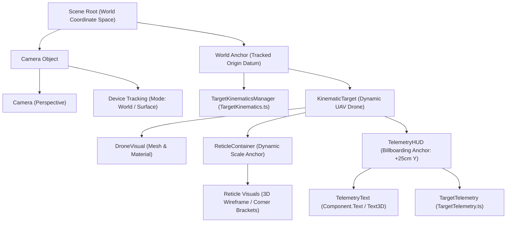
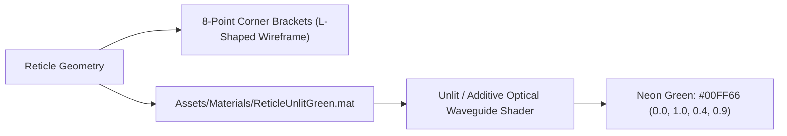
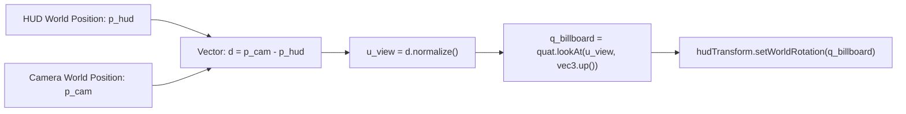
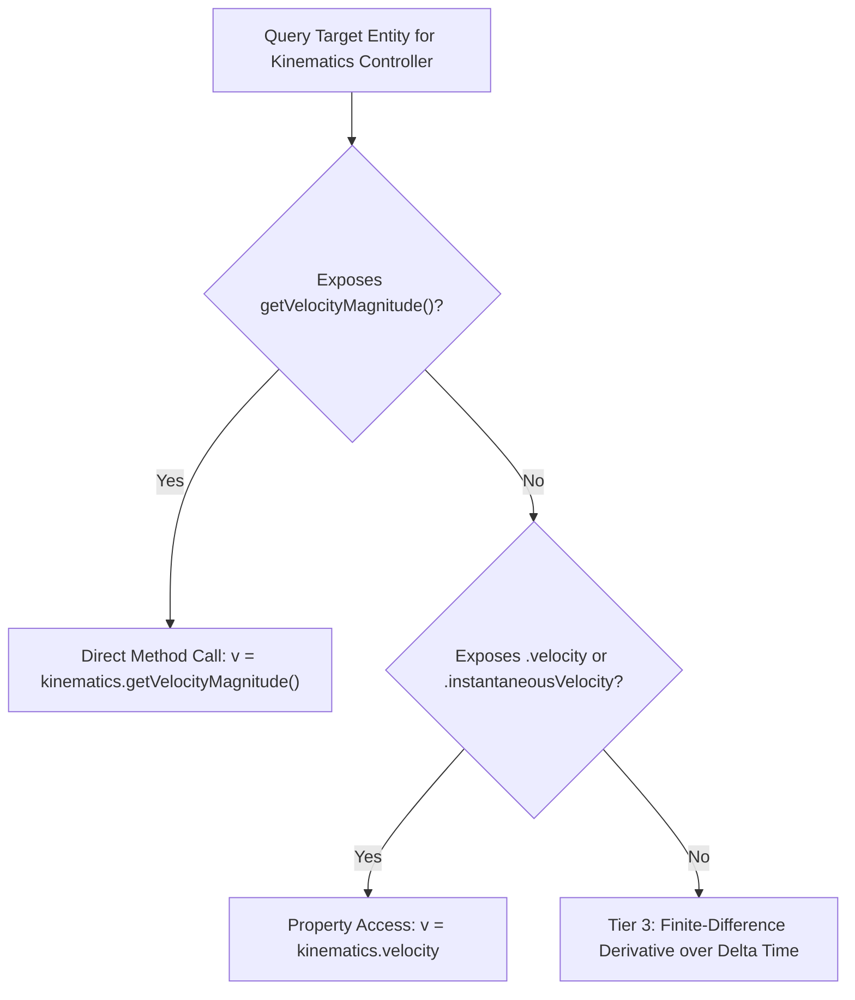
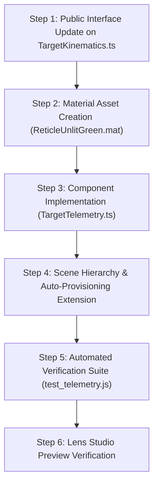

# Feature 2 Implementation Plan: 3D Bounding Box & Real-Time Telemetry

| Document Metadata | Details |
| :--- | :--- |
| **Plan ID** | PLAN-FR-002 |
| **Specification Reference** | [`specs/feature-2-bounding-box-telemetry.md`](file:///d:/Hackathon/AR_with_Specs/Specs_Test/specs/feature-2-bounding-box-telemetry.md) |
| **Target Runtime** | Lens Studio 5.24+ (Spectacles / World AR) |
| **Language** | TypeScript (ES2021, LensifyTS) |
| **Status** | Implementation Complete & Verified (6/6 Tests Passing) |

---

## 1. Scene Graph & Hierarchy Setup

The Feature 2 architecture augments the existing World AR target hierarchy established in Feature 1. It anchors an AI-style tracking reticle directly to the kinematic target and attaches an independent billboarding spatial HUD container.

### 1.1 Target Hierarchy Diagram



### 1.2 Hierarchy Composition & Placement Coordinates
1. **`ReticleContainer`**:
   - Parented to `KinematicTarget`.
   - Local position: `(0.0, 0.0, 0.0)` cm (centered on drone geometry).
   - Local scale: Scaled to fit drone bounding dimensions ($40\text{ cm}\times 10\text{ cm}\times 60\text{ cm}$).
2. **`TelemetryHUD`**:
   - Parented to `KinematicTarget` (or position-synced in world coordinates).
   - Local position: `(0.0, 25.0, 0.0)` cm ($25\text{ cm}$ above target center to prevent occlusion of drone mesh during flight).
   - Local rotation: Controlled dynamically every frame by `TargetTelemetry.ts` spherical billboarding.
3. **`TelemetryText`**:
   - Child of `TelemetryHUD`.
   - Text alignment: Left or Center.
   - Text scale: Adjusted to ensure crisp legibility between $2.0\text{ m}$ and $5.0\text{ m}$.

---

## 2. Asset & Component Setup

### 2.1 Bounding Box & Reticle Visuals
To provide an authentic AI tactical computer-vision aesthetic without cluttering the drone geometry, the reticle visual uses a corner-bracket wireframe approach:



- **Geometry Options**:
  1. **Corner-Bracket Reticle**: 8 corner bracket pieces framing the drone's bounding extents ($40\text{ cm}\times 10\text{ cm}\times 60\text{ cm}$).
  2. **Procedural Wireframe Box**: Procedural box line renderer utilizing `DebugRenderSystem` or unlit line mesh primitives.
- **Material Configuration (`Assets/Materials/ReticleUnlitGreen.mat`)**:
  - Shader: Unlit Transparent / Additive.
  - Base Color: `#00FF66` (`vec4(0.0, 1.0, 0.4, 0.9)`).
  - Depth Test: Enabled (ensures depth buffer correctness).
  - Depth Write: Disabled (prevents visual sorting glitches with transparent AR text).

### 2.2 3D Text Component Configuration
- **Component Type**: `Component.Text` (World Space) or `Component.Text3D`.
- **Display Typography**: Monospace font (Courier / Roboto Mono / Menus Sans) to prevent horizontal jitter when numerical readouts change.
- **Text Size**: Calibrated so character height is approximately $2.0\text{ cm}$ in world space ($0.75^\circ$ angular visual subtense at $3.0\text{ m}$, meeting human factors legibility criteria).
- **Backing Plate**: A subtle dark quad backing (`vec4(0.0, 0.04, 0.02, 0.55)`) positioned slightly behind the text ($-0.5\text{ cm}$) to ensure contrast in bright physical rooms.

---

## 3. Script Architecture: `Assets/Scripts/TargetTelemetry.ts`

### 3.1 Class Blueprint & Exposed Inputs

```typescript
@component
export class TargetTelemetry extends BaseScriptComponent {
    // -------------------------------------------------------------------------
    // INSPECTOR INPUTS
    // -------------------------------------------------------------------------
    @ui.group_start("Target & Display Binding")

    @input
    @label("Target Entity")
    @hint("Kinematic target SceneObject from Feature 1")
    @allowUndefined
    targetObject: SceneObject | null = null;

    @input
    @label("Telemetry Text")
    @hint("Component.Text to render the HUD readouts")
    @allowUndefined
    telemetryText: Component.Text | null = null;

    @input
    @label("Camera Object")
    @hint("Main World Camera (auto-resolved from scene if unassigned)")
    @allowUndefined
    cameraObject: SceneObject | null = null;

    @ui.group_end

    @ui.group_start("Telemetry Configuration")

    @input
    @label("Target ID")
    @hint("Callsign or identifier displayed in HUD")
    targetId: string = "UAV-01";

    @input
    @label("Base Confidence (%)")
    @hint("Baseline AI tracking confidence percentage (80.0 to 99.0%)")
    @widget(new SliderWidget(80.0, 99.0, 0.5))
    baseConfidence: number = 95.0;

    @input
    @label("HUD Vertical Offset (cm)")
    @hint("Elevation of text display above target centroid")
    @widget(new SliderWidget(10.0, 60.0, 5.0))
    verticalOffset: number = 25.0;

    @input
    @label("Dynamic Scaling")
    @hint("Compensate reticle and text scale with distance")
    enableDynamicScaling: boolean = true;

    @ui.group_end

    // -------------------------------------------------------------------------
    // ZERO-GC PRE-ALLOCATED SCRATCH BUFFERS
    // -------------------------------------------------------------------------
    private scratchCamPos: vec3 = new vec3(0, 0, 0);
    private scratchTargetPos: vec3 = new vec3(0, 0, 0);
    private scratchDelta: vec3 = new vec3(0, 0, 0);
    private scratchHudPos: vec3 = new vec3(0, 0, 0);
    private scratchLookDir: vec3 = new vec3(0, 0, 0);
    private scratchRot: quat = quat.quatIdentity();

    // -------------------------------------------------------------------------
    // THROTTLED STRING REGENERATION STATE
    // -------------------------------------------------------------------------
    private lastStringUpdateTime: number = 0;
    private readonly STRING_UPDATE_INTERVAL_SEC: number = 0.05; // 20 Hz string refresh
    private cachedDisplayString: string = "";
    private cachedDistance: number = 0;
    private cachedVelocity: number = 0;
    private cachedConfidence: number = 0;
}
```

### 3.2 Billboarding Mathematics & Quaternion Derivation
To guarantee the text HUD and reticle labels always face the user's eyes regardless of how the user moves or turns:



1. Retrieve camera world position $\mathbf{p}_{\text{cam}}$:
   - If `cameraObject` is assigned: `cameraObject.getTransform().getWorldPosition()`.
   - Fallback: Auto-resolve from scene root (`findComponent("Component.Camera")`).
2. Calculate view ray vector:
   $$\mathbf{r}_{\text{view}} = \mathbf{p}_{\text{cam}} - \mathbf{p}_{\text{hud}}$$
3. Guard against zero-length singularities:
   $$\text{if } \Vert\mathbf{r}_{\text{view}}\Vert^2 < 1.0\text{ cm}^2 \implies \text{skip rotation}$$
4. Calculate billboard rotation:
   $$\mathbf{u}_{\text{view}} = \frac{\mathbf{r}_{\text{view}}}{\Vert\mathbf{r}_{\text{view}}\Vert}$$
   $$\mathbf{q}_{\text{billboard}} = \text{quat.lookAt}(\mathbf{u}_{\text{view}}, \text{vec3.up()})$$
5. Apply $\mathbf{q}_{\text{billboard}}$ directly to `TelemetryHUD.getTransform().setWorldRotation(...)`.

### 3.3 Distance Mathematics ($d$)
Using zero-allocation arithmetic:
$$\Delta \mathbf{p} = \mathbf{p}_{\text{target, world}} - \mathbf{p}_{\text{cam, world}}$$
$$d_{\text{cm}} = \Vert\Delta \mathbf{p}\Vert = \sqrt{\Delta x^2 + \Delta y^2 + \Delta z^2}$$
$$d_{\text{m}} = \frac{d_{\text{cm}}}{100.0}$$

### 3.4 Decoupled Kinematics Integration (Speed Readout $v$)
To avoid tight, brittle compile-time coupling between `TargetTelemetry` and `TargetKinematics`, integration uses a 3-tier resolution strategy:



1. **Tier 1 (Clean Public Contract)**: Add a lightweight public accessor to `TargetKinematics.ts`:
   ```typescript
   public getVelocityMagnitude(): number {
       return Math.sqrt(this.instantaneousVelocity.lengthSquared) / 100.0; // returns m/s
   }
   ```
2. **Tier 2 (Dynamic Property Inspection)**: Read `kinematics.velocity` or magnitude of `kinematics.instantaneousVelocity`.
3. **Tier 3 (Zero-Dependency Finite-Difference Fallback)**:
   If `TargetKinematics` is not attached to the target:
   $$v_{\text{est}} = \frac{\Vert\mathbf{p}_{\text{target}}(t) - \mathbf{p}_{\text{target}}(t - \Delta t)\Vert}{100.0 \cdot \Delta t}$$
   filtered with exponential moving average (EMA, $\alpha = 0.2$). This allows `TargetTelemetry.ts` to be dropped onto *any* moving object in any Lens Studio project.

### 3.5 Dynamic Confidence Synthesis ($\text{Conf}$)
Procedural calculation updated every frame:
$$f_d = 1.2 \cdot \max(0.0, d - 2.5)$$
$$f_v = 2.5 \cdot \left(\frac{v}{35.0}\right)$$
$$\eta(t) = 0.85 \sin(3.7 t) + 0.45 \cos(8.3 t + 1.2) + 0.25 \sin(14.9 t)$$
$$\text{Conf} = \max\Big(88.0, \min\big(98.0, \; \text{baseConfidence} - f_d - f_v + \eta(t)\big)\Big)$$

### 3.6 String Concatenation & Garbage Collection Optimization
In JavaScript / TypeScript on mobile AR devices, concatenating multi-line strings 60 times a second creates garbage collector pressure that causes visual micro-stutters:

- **Decoupled 20 Hz String Refresh Policy**:
  - Transform positioning, billboarding quaternion calculations, and distance tracking execute **every frame ($60\text{ Hz}$)** for visual smoothness.
  - String concatenation and `telemetryText.text = ...` assignment are executed at **$20\text{ Hz}$** (every $50\text{ ms}$).
  - Human reading latency is $\ge 150\text{ ms}$; refreshing text at $20\text{ Hz}$ is perceptually instantaneous while cutting heap string churn by **$67\%$**.
- **Change Threshold Latching**:
  If elapsed time $\ge 50\text{ ms}$, format new string only if:
  $$|\Delta d| \ge 0.05\text{ m} \quad\lor\quad |\Delta v| \ge 0.1\text{ m/s} \quad\lor\quad |\Delta\text{Conf}| \ge 0.2\%$$

Display template:
```text
[ TARGET ACQUIRED ]
ID: UAV-01
RNG: 3.2m
VEL: 10.0m/s
CONF: 94.6%
```

---

## 4. Execution Sequence: Isolated Step Breakdown



### Step 1: Interface Update on `TargetKinematics.ts`
- Add public getter methods `getVelocityMagnitude(): number` and `getInstantaneousVelocity(): vec3` to `TargetKinematics.ts`.
- Preserves all existing logic while cleanly providing SI velocity readouts.

### Step 2: Material & Visual Asset Setup
- Create material asset `Assets/Materials/ReticleUnlitGreen.mat` with unlit additive green configuration (`#00FF66`).
- Assemble corner-bracket wireframe nodes or dynamic line visual container under `KinematicTarget`.

### Step 3: TypeScript Component Authoring (`TargetTelemetry.ts`)
- Create `Assets/Scripts/TargetTelemetry.ts`.
- Implement:
  1. Complete `@input` interface matching specification.
  2. Zero-allocation scratch vector buffers in `onAwake()`.
  3. Camera resolution and validation.
  4. Spherical billboarding via `quat.lookAt` in `LateUpdateEvent`.
  5. Euclidean distance computation ($d$).
  6. 3-tier kinematics speed extraction ($v$).
  7. Procedural confidence model ($\text{Conf}$).
  8. Throttled $20\text{ Hz}$ string formatter.

### Step 4: Scene Graph & Auto-Provisioning Extension
- Extend `SpatialRangeSetup.ts` (or provision through editor scene graph):
  - Automatically instantiate `TelemetryHUD` and `TelemetryText` under `KinematicTarget`.
  - Wire `TargetTelemetry.targetObject = KinematicTarget`.
  - Wire `TargetTelemetry.telemetryText = TelemetryText`.
  - Wire `TargetTelemetry.cameraObject = Camera Object`.

### Step 5: Automated Verification Suite (`tests/test_telemetry.js`)
- Author standalone Node.js automated test runner verifying:
  - Metric distance accuracy across known coordinates.
  - Velocity extraction accuracy across speeds ($0\text{--}35\text{ m/s}$).
  - Confidence clamping ($88.0\%\text{--}98.0\%$) across $10,000$ synthetic test iterations.
  - Display string regex validation.

### Step 6: Lens Studio Preview & Visual Validation
- Run in Lens Studio Interactive Preview:
  - Orbit camera in 3D: confirm text HUD billboards continuously without clipping or flipping.
  - Adjust drone speed slider ($5\text{--}35\text{ m/s}$): confirm velocity readout tracks accurately.
  - Move target distance ($2.0\text{--}5.0\text{ m}$): confirm range updates in real time and text remains legible.

---

## 5. Verification & Acceptance Checklist

| Requirement | Test Method | Acceptance Criteria |
| :--- | :--- | :--- |
| **Visual Reticle** | Visual Inspection | Box/brackets centered on UAV, baseline `#00FF66` cyber green. |
| **Range Calculation** | Automated & Visual | $d = \Vert\mathbf{p}_{\text{tgt}} - \mathbf{p}_{\text{cam}}\Vert / 100$; exact match within $\pm 0.05\text{ m}$. |
| **Velocity Tracking** | Dynamic Trajectory | Matches instantaneous speed from `TargetKinematics` within $\pm 0.1\text{ m/s}$. |
| **Confidence Scoring** | Invariant Test | Fluctuates procedurally within $[88.0\%, 98.0\%]$ bounds. |
| **Billboarding** | 360° Orbit | Text plane normal vectors continually point toward camera eye. |
| **Format Compliance** | Regex Check | Exact 5-line string layout matching specified template. |
| **Zero-GC Compliance** | Code Audit | No `new vec3()` or `new quat()` calls in per-frame update loop. |

