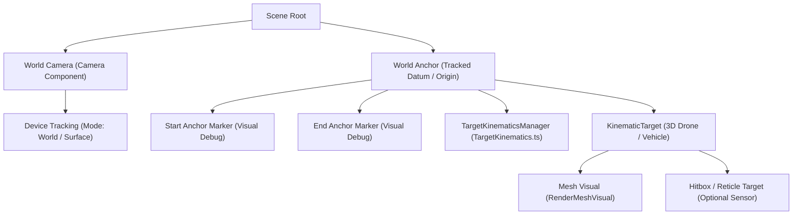

# Feature 1 Specification: Spatial Test Range & Target Kinematics

| Metadata | Details |
| :--- | :--- |
| **Document ID** | SPEC-FR-001 |
| **Feature Title** | Spatial Test Range & Target Kinematics |
| **Target System** | Snap Lens Studio (Lens API / TypeScript) |
| **Status** | Approved Specification |
| **Version** | 1.0.0 |
| **Category** | Core Simulation / Spatial Tracking |

---

## 1. Executive Summary & Objectives

The purpose of this specification is to define the architectural, mathematical, and component-level requirements for **Feature 1: Spatial Test Range & Target Kinematics**. 

This feature establishes an augmented reality (AR) spatial testing range anchored to physical surfaces (floor or tabletop) using Lens Studio World Tracking. Within this anchored coordinate space, a high-velocity 3D kinematic target (representing an Unmanned Aerial Vehicle / UAV drone) navigates along a configurable trajectory at flight speeds between $5.0\text{ m/s}$ and $35.0\text{ m/s}$ across a metric distance of $2.0\text{ m}$ to $5.0\text{ m}$.

### Core Objectives
1. **Physical World Anchoring**: Establish a drift-resilient horizontal tracking frame relative to the physical environment using 6DoF World Tracking.
2. **High-Speed Aerial Kinematics**: Accurately simulate UAV velocities ($5.0\text{–}35.0\text{ m/s}$ / $18.0\text{–}126.0\text{ km/h}$) with strict frame-rate independence.
3. **Engine-Metric Unit Integrity**: Bridge user-facing metric values (meters, meters per second) with Lens Studio's internal centimeter-based coordinate system ($1\text{ m} = 100\text{ cm}$).
4. **Boundary Discontinuity Smoothing**: Mitigate visual teleportation, spatial jitter, and infinite-acceleration impulses when transitioning or reversing trajectory direction at travel boundaries.

---

## 2. Coordinate System & Unit Calibration

Lens Studio uses a right-handed spatial coordinate system with specific unit standards that govern all translational and rotational calculations:

```mermaid
graph LR
    subgraph Engine Coordinates ["Lens Studio Engine Space (Centimeters)"]
        direction TB
        X["+X : Spatial Right"]
        Y["+Y : Spatial Up"]
        Z["+Z : Spatial Forward (Viewer faces -Z)"]
    end
    subgraph Metric Space ["Specification & User Inputs (SI Units)"]
        direction TB
        m["Distance : Meters (m)"]
        mps["Velocity : Meters / Second (m/s)"]
    end
    Metric Space -->|Scale Factor x 100.0| Engine Coordinates
```

### 2.1 Metric-to-Engine Conversions
- **Distance**: $d_{\text{engine}} = d_{\text{metric}} \times 100.0\text{ cm/m}$
  - A path length of $L = 3.0\text{ m}$ corresponds to $300.0\text{ cm}$ in engine space.
- **Velocity**: $v_{\text{engine}} = v_{\text{metric}} \times 100.0\text{ (cm/s) / (m/s)}$
  - A velocity of $v = 10.0\text{ m/s}$ corresponds to $1000.0\text{ cm/s}$ in engine space.
  - At maximum speed $v = 35.0\text{ m/s}$, target moves $3500.0\text{ cm/s}$ ($3.5\text{ cm/ms}$).
- **Rotation**: Lens Studio runtime script API uses **radians** for trigonometric and angular transformations, whereas the Editor API and Inspector expose **degrees**.

---

## 3. Scene Hierarchy & Architectural Composition

To maintain tracking stability and isolate the kinematic motion from camera-induced drift, all target motion is computed in **local space** relative to an anchored parent container.



### 3.1 Component Allocation
- **`WorldAnchor` (`SceneObject`)**: Serves as the zero-reference datum ($[0, 0, 0]$ local) pinned to the detected surface plane.
- **`TargetKinematicsManager` (`SceneObject`)**: Holds the `TargetKinematics.ts` script component, controlling calculation cycles and exposed Inspector controls.
- **`KinematicTarget` (`SceneObject`)**: The animated payload object containing the 3D visual model, transform components, and orientation vectors.

---

## 4. Functional Requirements

### FR-1: World Anchor & Device Tracking
- **Mode Selection**: The scene must utilize Lens Studio's `DeviceTracking` component configured with `DeviceTrackingMode.World` (Surface tracking).
- **Surface Locking**: The coordinate frame locks to a horizontal ground plane or tabletop surface. The target trajectory runs parallel to or elevated at a fixed altitude above this planar surface.
- **Relocalization Resilience**: When tracking is disrupted or undergoing relocalization, kinematics calculation must either latch current phase or pause execution to prevent runaway translation.

### FR-2: Kinematic Target Entity
- **Representation**: A 3D model or placeholder geometric target (e.g., UAV drone mesh, aerodynamic fuselage, or calibrated geometric proxy).
- **Local Hierarchy Placement**: The target must be a child of `WorldAnchor` or controlled strictly in the anchor's local coordinate frame.
- **Heading Realignment**: The target entity must automatically align its forward orientation ($+Z$ or custom forward axis) along its instantaneous velocity vector:
  $$\mathbf{u}_{\text{fwd}} = \frac{\mathbf{v}(t)}{\|\mathbf{v}(t)\|}$$
  When turnaround occurs, orientation must smoothly interpolate (via spherical linear interpolation / Slerp) to avoid 1-frame visual flipping.

### FR-3: Motion Controller (`TargetKinematics.ts`)
- **Lifecycle & Execution**: The controller must be written in TypeScript, extending `BaseScriptComponent`, and bind its execution cycle to `UpdateEvent`.
- **Supported Motion Trajectories**:
  1. **Ping-Pong Mode (`Linear Ping-Pong`)**: Target navigates back and forth between position $\mathbf{p}_{\text{start}}$ and $\mathbf{p}_{\text{end}}$ along a defined vector $\mathbf{u}_{\text{dir}}$.
  2. **Closed-Loop Mode (`Continuous Loop`)**: Target travels from start to end, executing a continuous loop trajectory (e.g., racetrack oval with semicircular turnaround caps or wrap-around reset with visual fade).
- **Kinematic Formulation**:
  - Incremental displacement formulation:
    $$\Delta \mathbf{p} = \mathbf{u}_{\text{dir}} \cdot (v \cdot 100.0) \cdot \Delta t$$
    where:
    - $\mathbf{u}_{\text{dir}}$ is the normalized direction unit vector in local coordinates.
    - $v$ is user velocity in meters per second ($v \in [5.0, 35.0]\text{ m/s}$).
    - $\Delta t$ is delta time in seconds, retrieved via `getDeltaTime()`.
  - Frame-Rate Invariance: Kinematic position must be strictly determined by accumulated elapsed time or delta-time integration to ensure identical spatial distance traversed regardless of frame rate fluctuations ($30\text{ FPS}$ vs $60\text{ FPS}$).

### FR-4: Editor Controls & Inspector Inputs
The component must expose clean, validated `@input` properties matching Lens Studio Inspector conventions:

| Property Identifier | TypeScript Decorator / Type | Default | Valid Range | Unit | Description |
| :--- | :--- | :--- | :--- | :--- | :--- |
| `velocity` | `@input float velocity` | `10.0` | `[5.0, 35.0]` | $\text{m/s}$ | Trajectory flight speed |
| `pathLength` | `@input float pathLength` | `3.0` | `[2.0, 5.0]` | $\text{m}$ | Distance between boundaries |
| `targetObject` | `@input SceneObject targetObject` | `null` | Non-null SceneObject | N/A | Target entity to displace |
| `motionMode` | `@input int motionMode` | `0` | `{0: PingPong, 1: ClosedLoop}` | Enum | Trajectory loop style |
| `motionAxis` | `@input vec3 motionAxis` | `vec3(1, 0, 0)` | Normalized unit vector | Vector3 | Spatial axis of motion |
| `smoothingZone` | `@input float smoothingZone` | `0.4` | `[0.1, 1.0]` | $\text{m}$ | Turnaround deceleration zone |
| `autoOrientTarget`| `@input bool autoOrientTarget` | `true` | Boolean | N/A | Rotate model to face motion |

```typescript
// Inspector Interface Definition Template (TargetKinematics.ts)
@component
export class TargetKinematics extends BaseScriptComponent {
    @input
    @widget(new SliderWidget(5.0, 35.0, 0.5))
    velocity: number = 10.0; // Speed in m/s

    @input
    @widget(new SliderWidget(2.0, 5.0, 0.1))
    pathLength: number = 3.0; // Path length in meters

    @input
    targetObject: SceneObject; // 3D target drone entity

    @input
    @widget(new ComboBoxWidget([new ComboBoxItem("Ping-Pong", 0), new ComboBoxItem("Closed-Loop", 1)]))
    motionMode: number = 0;

    @input
    motionAxis: vec3 = new vec3(1.0, 0.0, 0.0); // Travel vector (X-axis default)

    @input
    @widget(new SliderWidget(0.1, 1.0, 0.05))
    smoothingZone: number = 0.4; // Boundary deceleration buffer in meters

    @input
    autoOrientTarget: boolean = true;
}
```

### FR-5: Boundary Smoothing & Turnaround Dynamics
At speeds up to $35.0\text{ m/s}$ ($3500.0\text{ cm/s}$), instant vector reversal ($\mathbf{v} \to -\mathbf{v}$) causes infinite acceleration ($\mathbf{a} = \infty$), visual tearing, motion blur smearing, and severe perceptual dislocation in wearable AR displays.

#### 5.1 Ping-Pong Turnaround Profiles
Two mathematical smoothing profiles are specified for boundary turnaround:

1. **Continuous Harmonic Formulation (Sinusoidal Trajectory)**:
   Position along the normalized axis $u \in [-1, 1]$ as a continuous function of time $t$:
   $$x(t) = \frac{L_{\text{cm}}}{2} \cdot \sin\left(\frac{2\pi v_{\text{cm}}}{2 L_{\text{cm}}} \cdot t\right) = \frac{L_{\text{cm}}}{2} \cdot \sin\left(\frac{\pi v}{L} \cdot t\right)$$
   - *Advantage*: Guaranteed continuity in $C^\infty$ (continuous derivatives: position, velocity, and acceleration are all smooth). Zero drift, zero coordinate teleportation.

2. **Trapezoidal Profile with S-Curve Deceleration (Piecewise Kinematic)**:
   - For travel outside the boundary buffer ($|x| < \frac{L}{2} - d_{\text{smooth}}$): target moves at constant nominal velocity $v$.
   - Within the boundary smoothing zone ($d_{\text{smooth}}$): velocity scales using a smooth Hermite or cosine ease-out down to zero, inverts direction, and accelerates smoothly back to nominal speed.
   - Deceleration factor:
     $$k(d) = \frac{1}{2}\left(1 - \cos\left(\pi \frac{d}{d_{\text{smooth}}}\right)\right)$$

#### 5.2 Closed-Loop Turnaround Profile
- In Closed-Loop mode, the trajectory consists of two parallel linear segments connected by semicircular end-caps with radius $R = \frac{d_{\text{smooth}}}{2}$:
  - Forward stroke along vector $+\mathbf{u}_{\text{dir}}$ at offset $+Y_{\text{offset}}$.
  - Semicircular arc turnaround preserving constant linear velocity $v$.
  - Return stroke along vector $-\mathbf{u}_{\text{dir}}$ at offset $-Y_{\text{offset}}$ (or lateral offset $Z_{\text{offset}}$).
  - Eliminates coordinate snaps and provides continuous forward flight.

---

## 5. Mathematical & Numerical Considerations

### 5.1 Frame-Rate Independence & Discrete Step Analysis
At $v = 35.0\text{ m/s}$ and fluctuating display refresh rates, the inter-frame spatial displacement is significant:

| Display Refresh Rate | Frame Duration ($\Delta t$) | Step Displacement at $10\text{ m/s}$ | Step Displacement at $35\text{ m/s}$ |
| :--- | :--- | :--- | :--- |
| **60 FPS** | $16.67\text{ ms}$ | $16.67\text{ cm}$ | $58.33\text{ cm}$ |
| **30 FPS** | $33.33\text{ ms}$ | $33.33\text{ cm}$ | $116.67\text{ cm}$ ($> 1\text{ meter/frame}$) |
| **15 FPS (Thermal Throttled)** | $66.67\text{ ms}$ | $66.67\text{ cm}$ | $233.33\text{ cm}$ ($> 2.3\text{ meters/frame}$) |

### 5.2 Discrete Tunneling Mitigation
Because discrete steps at $35\text{ m/s}$ can exceed $100\text{ cm}$, simple naive Euler step checks (`if (pos.x > boundary) pos.x = boundary`) will cause:
1. **Overshoot / Tunneling**: Target jumps past the boundary point by up to a meter before the turn is registered.
2. **Velocity Asymmetry**: Truncating positions introduces phase delay and average speed error.

**Mandated Solution**:
The controller must use **analytical phase integration**:
$$\phi(t + \Delta t) = \left(\phi(t) + \frac{v \cdot \Delta t}{2 L}\right) \pmod 1.0$$
Position is evaluated directly from phase $\phi \in [0, 1)$, ensuring exact spatial consistency and zero boundary overshoot regardless of delta time spikes.

### 5.3 Delta-Time Clamping
To prevent simulation explosions during application pause, backgrounding, or garbage collection spikes, $\Delta t$ must be clamped:
$$\Delta t_{\text{clamped}} = \min(\Delta t, 0.05\text{ s})$$

---

## 6. Edge Cases & Error Handling

| Scenario | Potential Failure Mode | Specification Mitigation |
| :--- | :--- | :--- |
| **Unassigned `targetObject`** | Null reference exception on `UpdateEvent` | Script checks `if (!this.targetObject) return;` and logs an actionable warning on initialization. |
| **Zero or Negative `pathLength`** | Division by zero during phase calculation | Enforce minimum threshold $L \ge 0.5\text{ m}$ in property setter/validation. |
| **Extreme Delta-Time Spikes** | Target jumps across entire test range | Clamp $\Delta t \le 0.05\text{ s}$; advance phase only by clamped interval. |
| **Surface Tracking Loss** | Target flies off into uncalibrated world space | Intercept tracking quality events; freeze kinematics when tracking state is lost. |
| **Sub-Millimeter Smoothing Zone** | Sharp velocity discontinuities and visual judder | Clamp `smoothingZone` to $[0.1 \times L, 0.4 \times L]$. |

---

## 7. Verification & Acceptance Criteria

### 7.1 Automated & Unit Verification Tests
- **Metric Velocity Validation**:
  - Set $v = 10.0\text{ m/s}$ and $L = 3.0\text{ m}$.
  - Target must traverse the $300\text{ cm}$ stroke in exactly $t = \frac{L}{v} = 0.30\text{ seconds}$ (excluding boundary smoothing zone).
- **Phase Continuity Test**:
  - Sample positions across 1,000 synthetic frames with variable $\Delta t \in [0.016, 0.066]\text{ s}$.
  - Assert that $\|\mathbf{p}(t) - \mathbf{p}(t-\Delta t)\| \le v \cdot \Delta t_{\text{clamped}} + \epsilon$.
- **Boundary Invariance Test**:
  - Target must never exceed the spatial envelope $\pm \left(\frac{L_{\text{cm}}}{2} + \epsilon\right)$ at any frame.

### 7.2 AR Visual & Ergonomic Verification
- **World Lock Inspection**: At zero velocity, target remains stationary relative to floor features without creeping or drifting.
- **High-Speed Perceptibility**: At $35\text{ m/s}$, the target remains visually stable and continuous without disappearing or hopping back and forth erratically.
- **Inspector Usability**: Sliders for `velocity` ($5\text{–}35\text{ m/s}$) and `pathLength` ($2\text{–}5\text{ m}$) respond dynamically in the Lens Studio Editor Preview without requiring script recompile.

---

## 8. Implementation Plan & File Manifest

The implementation of Feature 1 shall consist of the following artifacts (to be created in subsequent phases):

1. **`Assets/Scripts/TargetKinematics.ts`**: The core TypeScript component implementing `BaseScriptComponent`, inspector inputs, phase accumulation, and trajectory math.
2. **`Assets/Prefabs/UAVTarget.prefab`**: 3D vehicle target hierarchy with mesh, PBR material, and anchor transform.
3. **`Assets/Materials/TargetIndicator.mat`**: Visual contrast material optimized for AR displays (additive/bright coloration to maintain visibility on transparent displays).
4. **`specs/feature-1-spatial-range.md`**: This formal design specification document.

