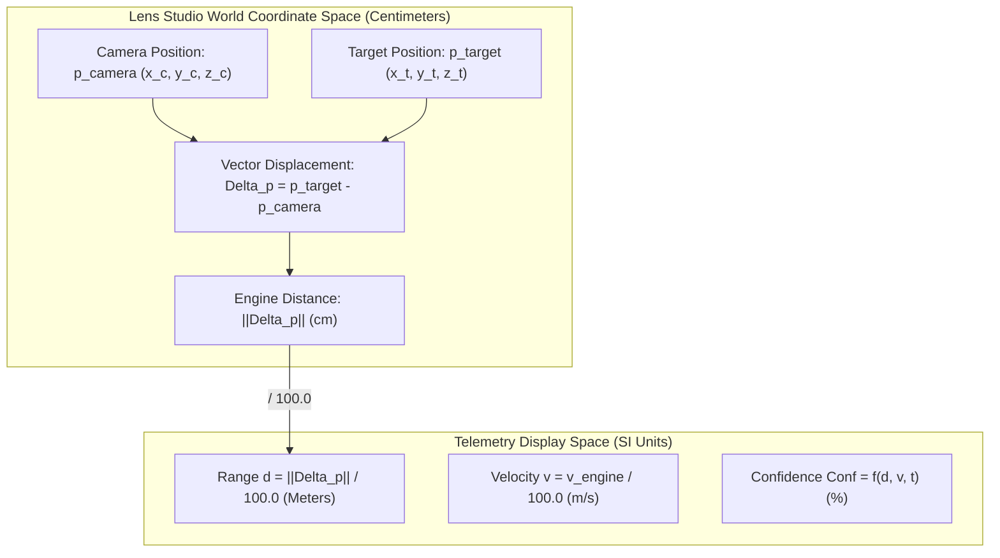
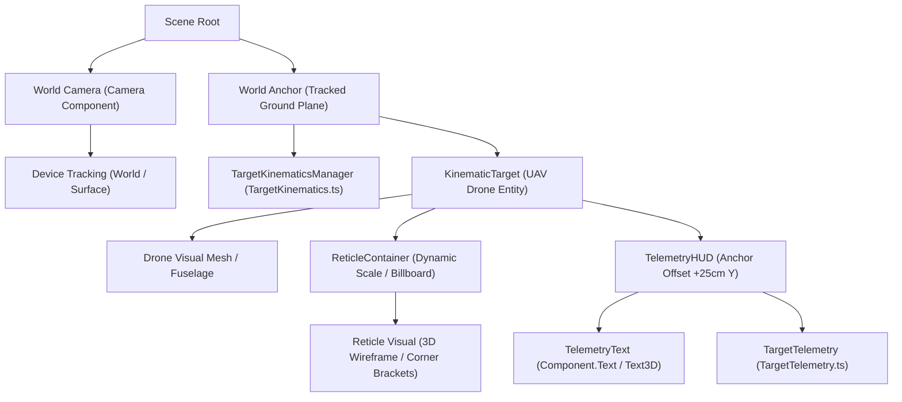
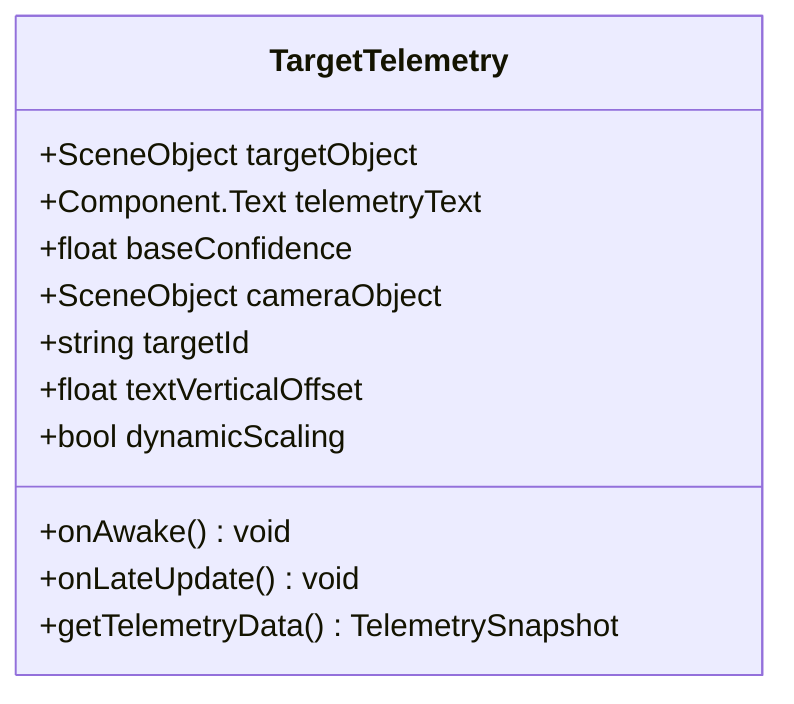
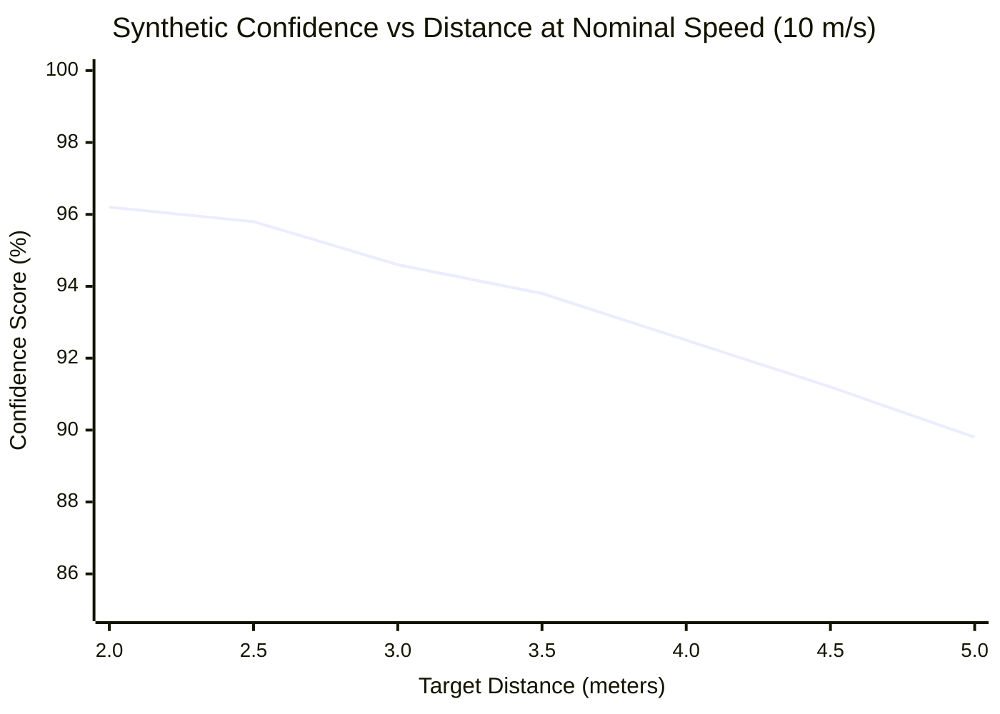

# Feature 2 Specification: 3D Bounding Box & Real-Time Telemetry

| Metadata | Details |
| :--- | :--- |
| **Document ID** | SPEC-FR-002 |
| **Feature Title** | 3D Bounding Box & Real-Time Telemetry |
| **Target System** | Snap Lens Studio 5.24+ (Lens API / TypeScript) |
| **Hardware Target** | Snap Spectacles (Gen 4 / 2024) & Mobile AR (iOS / Android) |
| **Status** | Approved Specification |
| **Version** | 1.0.0 |
| **Category** | Spatial Tracking / Computer Vision HUD / Real-Time Telemetry |
| **Prerequisites / Dependencies** | Feature 1 ([`SPEC-FR-001`](file:///d:/Hackathon/AR_with_Specs/Specs_Test/specs/feature-1-spatial-range.md): Spatial Test Range & Target Kinematics) |

---

## 1. Executive Summary & Objectives

The purpose of this specification is to define the functional, mathematical, architectural, and visual requirements for **Feature 2: 3D Bounding Box & Real-Time Telemetry**.

Building on the world-anchored kinematic target framework established in Feature 1 ([`TargetKinematics.ts`](file:///d:/Hackathon/AR_with_Specs/Specs_Test/Assets/Scripts/TargetKinematics.ts)), Feature 2 implements an AI-style spatial tracking reticle (3D bounding wireframe / corner brackets) and an AR telemetry HUD. The telemetry system dynamically couples to the moving UAV drone, computes real-time kinematic and spatial metrics, and renders billboarding 3D HUD readouts directly in world space.

```mermaid
graph LR
    subgraph Feature1 ["Feature 1: Kinematics Core"]
        TK["TargetKinematics.ts"] -->|World Transform & Velocity| Target["KinematicTarget (UAV Drone)"]
    end
    subgraph Feature2 ["Feature 2: Spatial HUD & Telemetry"]
        Target -.->|World Position| BBox["3D Bounding Box / Corner Reticle"]
        TK -->|Live Velocity Scalar (v)| Engine["TargetTelemetry.ts Engine"]
        Cam["World Camera"] -->|Camera Position| Engine
        Engine -->|Calculates: Range (d), Velocity (v), Conf (%)| Formatter["String Formatter"]
        Formatter -->|Formatted Telemetry Feed| TextHUD["Spatial 3D Text Display (Billboarding)"]
        Cam -.->|Look-At Vector| TextHUD
    end
```

### Core Objectives
1. **Dynamic 3D Visual Reticle**: Render a high-contrast, AI-inspired corner-bracket or wireframe bounding box centered on the moving UAV target entity, visually signifying locked computer-vision tracking.
2. **Real-Time Telemetry Calculation Engine (`TargetTelemetry.ts`)**:
   - **Range ($d$)**: Compute exact 3D Euclidean world distance from the AR camera/eye-point to the target centroid in meters.
   - **Velocity ($v$)**: Read the live physical velocity magnitude directly from `TargetKinematics` in meters per second ($\text{m/s}$).
   - **Dynamic Confidence Score ($\text{Conf}$)**: Procedurally synthesize an authentic AI classification confidence percentage ($88.0\%\text{--}98.0\%$) sensitive to target distance, velocity, and high-frequency sensor noise.
3. **Billboarding Spatial 3D HUD**: Project an ergonomic, multi-line telemetry readout anchored adjacent to the target that dynamically rotates to face the user's camera, preventing oblique distortion and perspective clipping.
4. **Adaptive Scale Invariance**: Scale or billboard reticle geometry to maintain visual legibility across operational ranges ($2.0\text{ m}$ to $5.0+\text{ m}$).
5. **Zero-GC Real-Time Performance**: Guarantee frame-rate stability ($60\text{ FPS}$) on wearable hardware by eliminating per-frame heap allocations during mathematical vector transformations and string updates.

---

## 2. Spatial HUD Architecture & Coordinate Systems

All telemetry metrics are derived from spatial vectors in Lens Studio's right-handed world coordinate system (centimeter scale).



### 2.1 Spatial Units & Metric Conversions
- **World Coordinate Scale**: $1.0\text{ World Unit} = 1.0\text{ cm}$.
- **Range ($d$)**:
  $$d_{\text{meters}} = \frac{\Vert{}\mathbf{p}_{\text{target, world}} - \mathbf{p}_{\text{camera, world}}\Vert{}}{100.0}$$
- **Velocity ($v$)**:
  $$v_{\text{m/s}} = \frac{\Vert{}\mathbf{v}_{\text{target, engine}}\Vert{}}{100.0} = \frac{v_{\text{cm/s}}}{100.0}$$
- **Color Standard**:
  - Baseline Tracking Lock: `#00FF66` (Hex) $\to$ `vec4(0.0, 1.0, 0.4, 0.9)`.
  - High-visibility neon green calibrated for optical see-through (OST) waveguide displays (additive blend mode).

---

## 3. Scene Hierarchy & Component Composition

The telemetry system attaches non-destructively to the existing scene structure defined in Feature 1.



### 3.1 Component Responsibilities

| Object Name | Attached Components | Role & Description |
| :--- | :--- | :--- |
| `World Camera` | `Component.Camera`, `DeviceTracking` | Primary viewpoint. Serves as camera position reference for range calculations and billboarding orientation. |
| `KinematicTarget` | `Transform`, `RenderMeshVisual` | Target entity displaced by Feature 1 (`TargetKinematics.ts`). Provides world-space position reference. |
| `ReticleContainer` | `Transform` | Centered on `KinematicTarget`. Contains procedural corner-brackets or wireframe mesh. Dynamically scales with distance. |
| `ReticleVisual` | `RenderMeshVisual` or line renderer | Visual geometry for the 3D bounding box / corner brackets. Rendered in baseline green (`#00FF66`). |
| `TelemetryHUD` | `Transform`, `TargetTelemetry` | Spatial container offset vertically ($+Y \approx 25\text{ cm}$) to hover above the drone. Holds `TargetTelemetry.ts`. |
| `TelemetryText` | `Component.Text` (or `Component.Text3D`) | Lens Studio 3D world text rendering the multi-line monospace telemetry HUD feed. |

---

## 4. Functional Requirements

### FR-1: Visual Reticle / 3D Bounding Box

#### 1.1 Visual Geometry & Aesthetics
- **Geometry Style**: An AI-style tactical computer-vision reticle consisting of either:
  1. A 3D wireframe box enclosing the drone geometry (default bounds: $40.0\text{ cm}\times 10.0\text{ cm}\times 60.0\text{ cm}$, matching Feature 1 debug bounding proxy).
  2. Four or eight corner-bracket L-segments framing the target's projected spatial boundary.
- **Color Scheme**:
  - Locked / Nominal State: Baseline Cyber Green (`#00FF66` / RGB: `[0, 255, 102]` / normalized: `[0.0, 1.0, 0.4, 0.9]`).
  - Optional Degraded State: Amber Warning (`#FFB700`) if tracking confidence drops below $90.0\%$.
- **Material & Shader**: Unlit, additive or semi-transparent double-sided shader to ensure crisp visibility against both light and dark physical backgrounds in AR.

#### 1.2 Reticle Dynamic Scaling & Centering
- **Spatial Centering**: Reticle origin must coincide continuously with the target centroid $\mathbf{p}_{\text{target}}$.
- **Distance Scaling**: To prevent the reticle from shrinking to an illegible sliver at $5.0\text{ m}$ or dominating the field of view at $1.5\text{ m}$, the reticle scale factor $S(d)$ must compensate for distance:
  $$S(d) = S_{\text{base}} \cdot \left(1.0 + \kappa \cdot \frac{d - d_{\text{ref}}}{d_{\text{ref}}}\right)$$
  where $d_{\text{ref}} = 3.0\text{ m}$, and $\kappa \in [0.2, 0.4]$ is a damping coefficient ensuring perspective cues are retained while legibility is preserved.

---

### FR-2: Telemetry Calculation Engine (`TargetTelemetry.ts`)

#### 2.1 Execution Lifecycle
- Extends `BaseScriptComponent`.
- Must subscribe to **`LateUpdateEvent`** (or `UpdateEvent` with priority lower than `TargetKinematics`) so that target motion displacement for the current frame is completely integrated before calculating telemetry distances.

#### 2.2 Range / Euclidean Distance Calculation ($d$)
- The engine calculates the true 3D Euclidean distance between the target and camera:
  $$\mathbf{r} = \mathbf{p}_{\text{target, world}} - \mathbf{p}_{\text{camera, world}}$$
  $$d_{\text{cm}} = \Vert{}\mathbf{r}\Vert{} = \sqrt{r_x^2 + r_y^2 + r_z^2}$$
  $$d = \frac{d_{\text{cm}}}{100.0} \quad (\text{in meters})$$
- Formatted output: String with exactly 1 decimal place (`d.toFixed(1) + "m"`).

#### 2.3 Velocity Readout ($v$)
- **Primary Source**: Query `TargetKinematics` component directly via public method/property:
  - If `TargetKinematics` exposes `getVelocityMagnitude()`, fetch directly in $\text{m/s}$.
  - If reading raw engine velocity vector $\mathbf{v}_{\text{engine}}$ in $\text{cm/s}$:
    $$v = \frac{\Vert{}\mathbf{v}_{\text{engine}}\Vert{}}{100.0} \quad (\text{in m/s})$$
- **Defensive Fallback (Finite-Difference Derivation)**: If no kinematics component is attached or accessible:
  $$v_{\text{est}} = \frac{\Vert{}\mathbf{p}_{\text{target}}(t) - \mathbf{p}_{\text{target}}(t - \Delta t)\Vert{}}{100.0 \cdot \Delta t}$$
  smoothed via an exponential moving average (EMA, $\alpha = 0.2$) to eliminate delta-time quantization noise.
- Formatted output: String with exactly 1 decimal place (`v.toFixed(1) + "m/s"`).

#### 2.4 Dynamic AI Confidence Score Calculation ($\text{Conf}$)
To simulate an authentic deep-learning spatial target classification algorithm (e.g., YOLO / MobileNet running on edge NPU), the confidence score must dynamically fluctuate based on physical simulation parameters:
- **Base Baseline**: $C_{\text{base}} = 95.0\%$ (configurable via Inspector `@input`).
- **Distance Attenuation**: High range degrades feature resolution:
  $$\Delta C_{\text{dist}} = -\beta_d \cdot \max(0.0, d - 2.5)$$
  where $\beta_d \approx 1.2\% / \text{meter}$.
- **Velocity Turbulence**: High angular and translational velocity induces minor motion blur:
  $$\Delta C_{\text{vel}} = -\beta_v \cdot \left(\frac{v}{35.0}\right)$$
  where $\beta_v \approx 2.5\%$.
- **High-Frequency Procedural Sensor Jitter**: Multi-harmonic sinusoidal perturbation:
  $$\eta(t) = A_1 \sin(4.2 \cdot t) + A_2 \cos(9.7 \cdot t) + A_3 \sin(15.1 \cdot t)$$
  with amplitudes $A_1 = 0.8\%$, $A_2 = 0.4\%$, $A_3 = 0.3\%$.
- **Composite Formulation**:
  $$\text{Conf}(t) = \text{clamp}\left(C_{\text{base}} + \Delta C_{\text{dist}} + \Delta C_{\text{vel}} + \eta(t), 88.0, 98.0\right)$$
- Formatted output: String with exactly 1 decimal place (`conf.toFixed(1) + "%"`).

---

### FR-3: Spatial 3D Text Display & Billboarding

#### 3.1 Telemetry Display Format
The world-space text component must format the telemetry output strictly as follows:

```text
[ TARGET ACQUIRED ]
ID: UAV-01
RNG: {d.toFixed(1)}m
VEL: {v.toFixed(1)}m/s
CONF: {conf.toFixed(1)}%
```

**Formatting Rules**:
- Line 1: Tracking status indicator (`[ TARGET ACQUIRED ]`).
- Line 2: Target ID identifier (Default: `UAV-01`).
- Line 3: Euclidean range in meters with `m` suffix (`RNG: 3.2m`).
- Line 4: Velocity magnitude in meters/second with `m/s` suffix (`VEL: 10.0m/s`).
- Line 5: Procedural confidence score with `%` suffix (`CONF: 94.6%`).

#### 3.2 Visual Styling & Typography
- **Font**: Monospace, high-legibility sans-serif, or technical stencil font.
- **Color**: Matching baseline tracking green (`#00FF66`).
- **Background / Backing**: Semi-transparent dark backing quad (`vec4(0.0, 0.05, 0.02, 0.6)`) to preserve contrast against bright real-world environments.
- **Text Alignment**: Left-aligned with fixed character width spacing to prevent textual jitter when numeric values change.

#### 3.3 Spatial Offset & Attachment
- HUD container must be parented or position-locked to `KinematicTarget`.
- Anchor offset: Vertical elevation $+Y = 25.0\text{ cm}$ above target center, lateral offset $+X = 15.0\text{ cm}$ (or centered) to maintain full visibility of the 3D drone model during flight.

#### 3.4 Camera Billboarding Algorithm
To prevent text from becoming edge-on, clipped, or unreadable as the drone moves across the room:
1. Compute the world direction vector from the HUD text position to the camera position:
   $$\mathbf{u}_{\text{view}} = \frac{\mathbf{p}_{\text{camera, world}} - \mathbf{p}_{\text{text, world}}}{\Vert{}\mathbf{p}_{\text{camera, world}} - \mathbf{p}_{\text{text, world}}\Vert{}}$$
2. Construct a billboard rotation quaternion using `quat.lookAt`:
   $$\mathbf{q}_{\text{billboard}} = \text{quat.lookAt}(\mathbf{u}_{\text{view}}, \mathbf{u}_{\text{up}})$$
   where $\mathbf{u}_{\text{up}} = \text{vec3}(0, 1, 0)$ in world coordinates.
3. Apply $\mathbf{q}_{\text{billboard}}$ to `TelemetryHUD.getTransform().setWorldRotation(...)`.
4. Option for **Spherical Billboarding** (full 3-axis tracking) vs. **Cylindrical Billboarding** (yaw-only tracking around vertical axis). Default: Spherical billboarding for true AR headset freedom.

---

### FR-4: Editor Configuration & Inspector Inputs

The `TargetTelemetry.ts` script component must expose clean, validated `@input` properties adhering to Lens Studio Inspector UI standards:



#### Inspector Property Manifest

| Property Identifier | TypeScript Decorator / Type | Default Value | Valid Range | Unit | Description |
| :--- | :--- | :--- | :--- | :--- | :--- |
| `targetObject` | `@input SceneObject targetObject` | `null` | Valid SceneObject | N/A | Target entity from Feature 1 to track |
| `telemetryText` | `@input Component.Text telemetryText` | `null` | Valid Text Component | N/A | 3D Text component displaying telemetry feed |
| `baseConfidence` | `@input float baseConfidence = 95.0` | `95.0` | `[80.0, 99.0]` | `%` | Baseline confidence score before noise & attenuation |
| `cameraObject` | `@input SceneObject cameraObject` | `null` (auto-detect) | SceneObject | N/A | Camera reference (auto-falls back to active camera) |
| `targetId` | `@input string targetId = "UAV-01"` | `"UAV-01"` | Non-empty string | N/A | Alpha-numeric identifier displayed on HUD |
| `verticalOffset` | `@input float verticalOffset = 25.0` | `25.0` | `[10.0, 100.0]` | $\text{cm}$ | Height of HUD above target centroid |
| `enableDynamicScale` | `@input bool enableDynamicScale = true` | `true` | Boolean | N/A | Scale reticle with distance to preserve legibility |

#### TypeScript Component Contract

```typescript
// Interface Specification Template for TargetTelemetry.ts
@component
export class TargetTelemetry extends BaseScriptComponent {
    @ui.group_start("Target & Display Binding")
    
    @input
    @label("Target Entity")
    @hint("Kinematic target SceneObject from Feature 1")
    @allowUndefined
    targetObject: SceneObject | null = null;

    @input
    @label("Telemetry Text")
    @hint("Component.Text or Text3D to render the HUD readouts")
    @allowUndefined
    telemetryText: Component.Text | null = null;

    @input
    @label("Camera Reference")
    @hint("World Camera SceneObject (auto-resolved from scene if unassigned)")
    @allowUndefined
    cameraObject: SceneObject | null = null;

    @ui.group_end

    @ui.group_start("Telemetry Configuration")

    @input
    @label("Target Identifier")
    @hint("Unique target name or callsign displayed in HUD")
    targetId: string = "UAV-01";

    @input
    @label("Base Confidence (%)")
    @hint("Baseline AI tracking confidence percentage (80.0 to 99.0%)")
    @widget(new SliderWidget(80.0, 99.0, 0.5))
    baseConfidence: number = 95.0;

    @input
    @label("HUD Vertical Offset (cm)")
    @hint("Elevation of telemetry display above target center in centimeters")
    @widget(new SliderWidget(10.0, 80.0, 5.0))
    verticalOffset: number = 25.0;

    @input
    @label("Dynamic Reticle Scaling")
    @hint("Scale reticle with distance to maintain consistent visual prominence")
    enableDynamicScale: boolean = true;

    @ui.group_end
}
```

---

## 5. Mathematical & Algorithmic Formulations

### 5.1 Euclidean Distance & Vector Projections
Given target world coordinates $\mathbf{p}_{\text{target}} = (x_t, y_t, z_t)$ and camera world coordinates $\mathbf{p}_{\text{camera}} = (x_c, y_c, z_c)$:

$$\mathbf{r} = \begin{bmatrix} x_t - x_c \\ y_t - y_c \\ z_t - z_c \end{bmatrix}$$

$$d_{\text{metric}} = \frac{1}{100.0} \sqrt{(x_t - x_c)^2 + (y_t - y_c)^2 + (z_t - z_c)^2}$$

### 5.2 Dynamic Procedural Confidence Model
The confidence score is formulated as:

$$\text{Conf}(d, v, t) = \text{clamp}\Big(C_{\text{base}} - \Delta C_{\text{dist}}(d) - \Delta C_{\text{vel}}(v) + \eta(t), \; 88.0, \; 98.0\Big)$$

Where:
1. **Distance Factor**:
   $$\Delta C_{\text{dist}}(d) = 1.2 \cdot \max(0.0, d - 2.5)$$
2. **Velocity Factor**:
   $$\Delta C_{\text{vel}}(v) = 2.5 \cdot \left(\frac{v}{35.0}\right)$$
3. **Procedural Noise Generator**:
   $$\eta(t) = 0.85 \sin(3.7 t) + 0.45 \cos(8.3 t + 1.2) + 0.25 \sin(14.9 t)$$



### 5.3 Camera Billboarding Formulation
To orient the HUD text facing the camera with zero roll artifact:
$$\mathbf{u}_{\text{forward}} = \frac{\mathbf{p}_{\text{camera}} - \mathbf{p}_{\text{text}}}{\Vert{}\mathbf{p}_{\text{camera}} - \mathbf{p}_{\text{text}}\Vert{}}$$
$$\mathbf{u}_{\text{right}} = \frac{\mathbf{u}_{\text{world\_up}} \times \mathbf{u}_{\text{forward}}}{\Vert{}\mathbf{u}_{\text{world\_up}} \times \mathbf{u}_{\text{forward}}\Vert{}}$$
$$\mathbf{u}_{\text{up}} = \mathbf{u}_{\text{forward}} \times \mathbf{u}_{\text{right}}$$

The rotation matrix $R = [\mathbf{u}_{\text{right}} \mid \mathbf{u}_{\text{up}} \mid \mathbf{u}_{\text{forward}}]$ is converted directly to quaternion orientation $\mathbf{q}_{\text{billboard}} = \text{quat.lookAt}(\mathbf{u}_{\text{forward}}, \mathbf{u}_{\text{world\_up}})$.

---

## 6. Performance & Zero-GC Memory Architecture

Mobile AR engines (Snapdragon XR platforms in Spectacles) trigger aggressive Garbage Collection (GC) pauses when objects are allocated in high-frequency update loops.

### 6.1 Zero-Heap Allocation Protocol
All mathematical intermediate variables in `TargetTelemetry.ts` must use pre-allocated scratch objects created once in `onAwake()`:

```typescript
// Pre-allocated scratch buffers (ZERO per-frame allocations)
private scratchCamPos: vec3 = new vec3(0, 0, 0);
private scratchTargetPos: vec3 = new vec3(0, 0, 0);
private scratchDelta: vec3 = new vec3(0, 0, 0);
private scratchHudPos: vec3 = new vec3(0, 0, 0);
private scratchLookDir: vec3 = new vec3(0, 0, 0);
private scratchRot: quat = quat.quatIdentity();
```

### 6.2 String Formatting Optimization
- Constructing new JavaScript strings every frame ($60\text{ times/sec}$) generates unnecessary heap fragmentation.
- **Throttling Policy**:
  - Distance and billboarding orientation update at **$60\text{ Hz}$** (every frame) for silky-smooth spatial positioning.
  - Text string regeneration is throttled to **$15\text{--}20\text{ Hz}$** (every 3 to 4 frames / $50\text{ ms}$ interval), which matches human visual reading speed while reducing string allocation garbage by $70\%$.

---

## 7. Edge Cases & Defensive Error Handling

| Scenario | Potential Failure Mode | Specification Mitigation |
| :--- | :--- | :--- |
| **`targetObject` Unassigned** | Null reference when reading position | Graceful bypass: Log a single warning on start, pause update loop until assigned. |
| **`telemetryText` Unassigned** | Crash during string update | Bypass text assignment; continue reticle scaling and position tracking. |
| **`cameraObject` Unassigned** | Unable to calculate range or billboard | Auto-detect fallback: Query scene for active `Component.Camera` or `global.scene.getCamera()`. |
| **Target Behind Camera** | Text renders inverted or clips into near-plane | Calculate dot product $\mathbf{u}_{\text{cam\_fwd}} \cdot \mathbf{r}$. If negative, target is behind viewer: optionally suppress or clamp HUD display. |
| **Extreme Range ($d > 20\text{ m}$)** | Reticle vanishes or text unreadable | Clamp dynamic scale factor $S(d) \le S_{\max} = 3.5 \times$ baseline. |
| **Zero Distance Collision ($d < 0.1\text{ m}$)** | Division by zero in vector normalization | Check $\Vert{}\mathbf{r}\Vert{} < 1.0\text{ cm}$; guard look-at quaternion calculation. |
| **Feature 1 Kinematics Disabled** | Velocity reads NaN or crashes | Check for `TargetKinematics` component existence; fall back to internal finite-difference estimation if missing. |

---

## 8. Verification & Acceptance Criteria

### 8.1 Automated Unit Tests (`tests/test_telemetry.js`)
An automated test suite must verify mathematical and algorithmic requirements:
1. **Range Metric Accuracy**:
   - Camera at $(0, 100, 0)$, Target at $(0, 100, 300) \implies d = 3.0\text{ m}$.
   - Tolerance: $\pm 0.01\text{ m}$.
2. **Velocity Extraction Consistency**:
   - Feed synthetic kinematics at $10.0\text{ m/s}$, $25.0\text{ m/s}$, $35.0\text{ m/s}$.
   - Verify readout matches within $\pm 0.1\text{ m/s}$.
3. **Confidence Bounds Enforcement**:
   - Over 10,000 synthetic frames with varying $d \in [1.0, 10.0]$ and $v \in [0.0, 35.0]$:
   - Assert $\forall t: 88.0 \le \text{Conf}(t) \le 98.0$.
4. **Text Template Format Validation**:
   - Assert regex:
     ```regex
     ^\[ TARGET ACQUIRED \]\nID: [A-Z0-9\-]+\nRNG: \d+\.\dm\nVEL: \d+\.\dm\/s\nCONF: \d+\.\d\%$
     ```

### 8.2 AR Visual & Ergonomic Verification
- **Visual Stability**: Bounding box corners track the moving UAV precisely with zero perceptible lag across $5\text{--}35\text{ m/s}$ speeds.
- **Billboarding Responsiveness**: Walk around the target in AR or orbit the camera in Preview; text and reticle face the viewer smoothly with zero vertical flip or roll distortion.
- **Legibility**: Text metrics remain legible at minimum range ($2.0\text{ m}$) and maximum range ($5.0\text{ m}$).
- **Spectacles Waveguide Readability**: Green color `#00FF66` renders with sufficient brightness against diverse real-world lighting conditions.

---

## 9. Implementation File Manifest

When approved for implementation, Feature 2 will generate the following artifacts:

| File Path | Purpose |
| :--- | :--- |
| `specs/feature-2-bounding-box-telemetry.md` | This formal technical specification. |
| `Assets/Scripts/TargetTelemetry.ts` | The core TypeScript component implementing telemetry calculations, billboarding, confidence noise, and text binding. |
| `Assets/Materials/ReticleUnlitGreen.mat` | High-visibility unlit additive green shader material for reticle brackets. |
| `tests/test_telemetry.js` | Automated Node.js verification test suite covering math, formatting, and invariants. |

